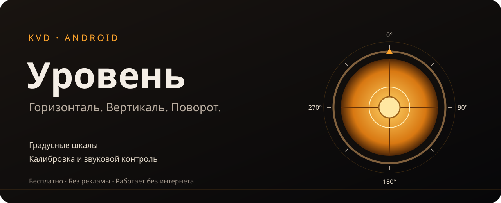
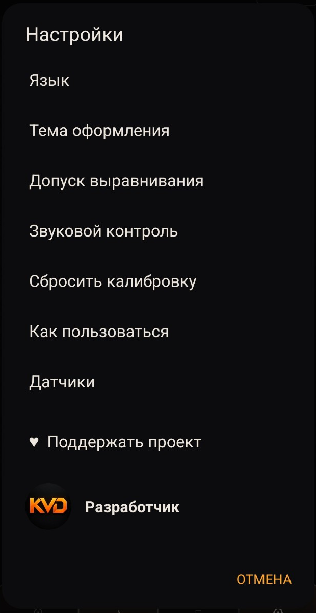
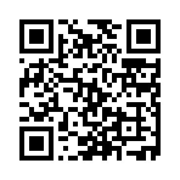
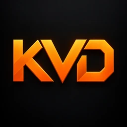

<div align="center">



# 📐 Uroven · Уровень

**Measure phone tilt and rotation with degree scales and audio feedback.**


### [⬇️ Download APK](https://github.com/1090kvd-cloud/URO/releases/latest)

**English** · [Русский](README.md)

</div>

## ✨ Features

| Feature | Description |
|---|---|
| 📐 Three vials | Horizontal, vertical and circular indicators for two-axis tilt |
| 🔢 Degree scales | X/Y tilt up to ±90° and a 0–360° rotation scale |
| 🔊 Audio feedback | Automatic selection, both axes or one individual vial |
| 🎯 Calibration | Set a reference tilt for your surface |
| 🔒 Hold | Freeze readings, including rotation |
| 🔄 Flat rotation | Relative rotation with a dedicated zero-reference button |
| 🎨 Appearance | Four themes and graphite KVD settings dialogs |
| 🌐 Languages | Russian and English |
| 📴 Offline | Measurements run locally; only the Boosty link requires a browser |

## 📸 Settings

<div align="center">

</div>

Actual settings screenshot supplied by the user from version 1.5.2. Version 1.5.3 applies the same palette to nested dialogs. The cover above is an illustration.

## 📥 Install

1. Open the [latest release](https://github.com/1090kvd-cloud/URO/releases/latest).
2. Expand **Assets**, download **Uroven-…apk** and open it on your phone.
3. If prompted by Android, allow installations from the browser or file manager opening the APK.

Requires **Android 8.0+**. Tilt measurement requires an accelerometer or gravity sensor. Flat rotation requires an Android rotation sensor or gyroscope.

Releases 1.5.1–1.5.3 share a signing certificate and can update one another. Earlier versions use a different certificate and must be uninstalled first, which removes their settings and calibration.

## 🧭 Usage

1. Place the back of your phone against the surface and wait for readings.
2. Read the vials and **X/Y** angles. Use **Calibration** to set your reference.
3. Enable sound; select the axis and tolerance in **Settings**.
4. For flat rotation, press the top **0°** button and rotate the phone.
5. Use **Hold** to freeze the readings.

Rotation is relative to a starting position, without a north reference. Drift can accumulate; reset the reference with **0°**. Check available sensors under **Settings → Sensors**. Accuracy depends on the phone sensors, calibration and contact with the surface.

## 🛠 Build and checks

Java, native Android Views and Canvas. Requires **JDK 17**, Android SDK 35 and build-tools 35.0.0.

```bash
git clone https://github.com/1090kvd-cloud/URO.git
cd URO
sh scripts/test.sh
export ANDROID_SDK_ROOT=/path/to/Android/Sdk
python3 scripts/build-apk.py
```

Calculation checks cover tilt, vial geometry, audio-axis selection and relative rotation. They do not replace testing the phone's physical sensors.

GitHub Actions artifacts contain a **development APK**, signed with a build-environment key. Use APKs from **Releases** to update the installed release app.

## ❤️ Support

The app is free. Donations are optional and do not unlock extra features.

**[Support KVD on Boosty](https://boosty.to/tvshortcutmaker/donate)**



A ⭐ or a useful [bug report](https://github.com/1090kvd-cloud/URO/issues) also helps.

## 👤 Developer



**KVD** · [Boosty](https://boosty.to/tvshortcutmaker) · [TV Shortcut Maker](https://github.com/1090kvd-cloud/TV-Sideload-Shortcut-Maker)
