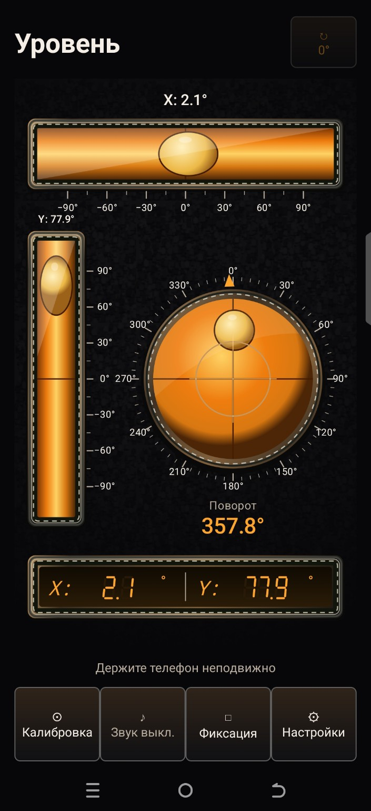

<div align="center">


# 📐 Уровень

**Проверяйте наклон и поворот телефона — с градусными шкалами и звуковым сигналом.**


### [⬇️ Скачать APK](https://github.com/1090kvd-cloud/URO/releases/latest)

**Русский** · [English](README.en.md)

</div>

## ✨ Возможности

| Функция | Что делает |
|---|---|
| 📐 Три колбы | Горизонтальная, вертикальная и круглая — для контроля двух осей |
| 🔢 Градусные шкалы | Наклоны X/Y до ±90° и круговая шкала поворота 0–360° |
| 🔊 Звуковой контроль | Автоматический выбор, обе оси или отдельная колба |
| 🎯 Калибровка | Задаёт нулевой наклон для выбранной поверхности |
| 🔒 Фиксация | Удерживает текущие показания, включая угол поворота |
| 🔄 Поворот плашмя | Относительный угол и кнопка «0°» для нового отсчёта |
| 🎨 Оформление | Четыре темы и графитовые настройки в стиле KVD |
| 🌐 Два языка | Русский и английский интерфейс |
| 📴 Без интернета | Измерения работают локально; браузер нужен только для ссылки на Boosty |

## 📸 Скриншоты

<table>
<tr><th>Главный экран</th><th>Настройки</th></tr>
<tr>
<td align="center" valign="top"></td>
<td align="center" valign="top"></td>
</tr>
</table>

Главный экран и меню настроек — реальные снимки пользователя. Снимок настроек сделан в версии 1.5.2; в 1.5.3 та же палитра применяется и к вложенным окнам. Обложка выше — иллюстрация приложения.

## 📥 Установка

1. Откройте [последний релиз](https://github.com/1090kvd-cloud/URO/releases/latest).
2. В разделе **Assets** скачайте файл **Uroven-…apk** и откройте его на телефоне.
3. Если Android попросит, разрешите установку для браузера или файлового менеджера, которым открываете APK.

**Требования:** Android 8.0 и новее. Для измерения наклона нужен датчик ускорения или гравитации. Для поворота плашмя — доступный Android датчик вращения либо гироскоп.

Релизы 1.5.1–1.5.3 используют один сертификат подписи и обновляются поверх друг друга. Версии до 1.5.1 подписаны другим ключом: при переходе потребуется удалить старую установку, что сбросит её настройки и калибровку.

## 🧭 Как пользоваться

1. Приложите заднюю сторону телефона к поверхности и дождитесь показаний.
2. Следите за колбами и значениями **X/Y**. При необходимости нажмите **«Калибровка»** для задания своего нуля.
3. Включите звук; нужную ось и допуск выберите в **настройках**.
4. Для измерения поворота плашмя нажмите **«0°»** сверху и поворачивайте телефон.
5. Нажмите **«Фиксация»**, чтобы удержать показания.

Поворот считается относительно начального положения, без привязки к северу. Угол может постепенно уходить — задайте «0°» заново. Доступность датчиков можно посмотреть в **Настройки → Датчики**. Точность зависит от датчиков телефона, калибровки и контакта корпуса с поверхностью.

## 🛠 Сборка и проверки

Java, стандартные Android Views и Canvas; Android SDK 35, build-tools 35.0.0 и JDK 17.

```bash
git clone https://github.com/1090kvd-cloud/URO.git
cd URO
sh scripts/test.sh
export ANDROID_SDK_ROOT=/путь/к/Android/Sdk
python3 scripts/build-apk.py
```

Расчётные проверки охватывают наклоны, геометрию колб, выбор звуковой оси и относительный поворот. Они не заменяют проверку датчиков на телефоне.

GitHub Actions собирает **тестовый APK** в артефактах. Он подписан ключом сборочной среды; для обновления установленного приложения используйте APK из **Releases**.

## ❤️ Поддержать проект

Приложение бесплатное. Донат добровольный и не открывает дополнительные функции.

**[Поддержать KVD на Boosty](https://boosty.to/tvshortcutmaker/donate)**


Можно также поставить ⭐ репозиторию или сообщить об ошибке в [Issues](https://github.com/1090kvd-cloud/URO/issues).

## 👤 Разработчик


**KVD** · [Boosty](https://boosty.to/tvshortcutmaker) · [TV Shortcut Maker](https://github.com/1090kvd-cloud/TV-Sideload-Shortcut-Maker)
